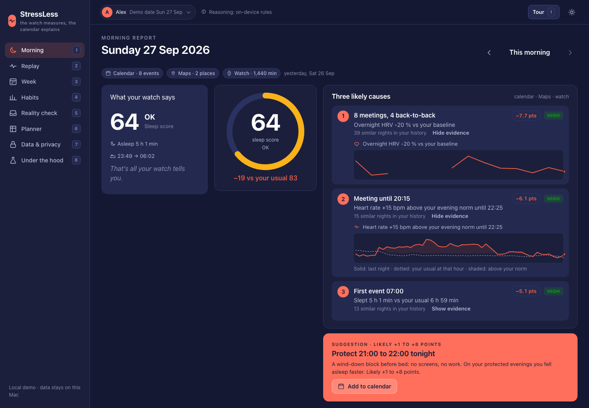
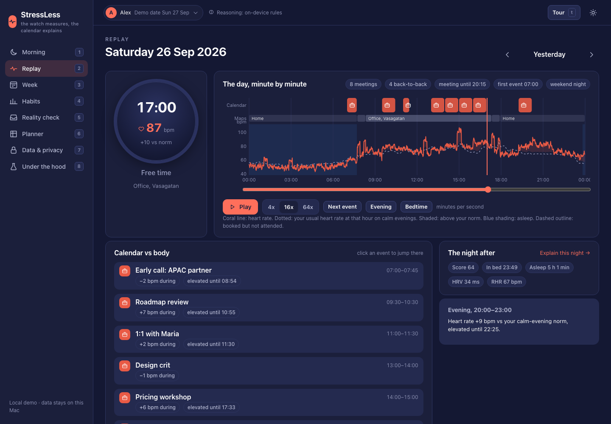
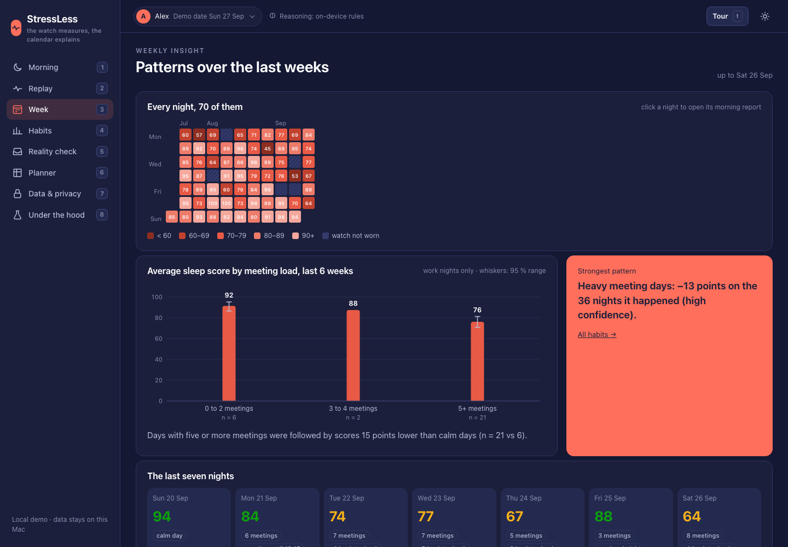
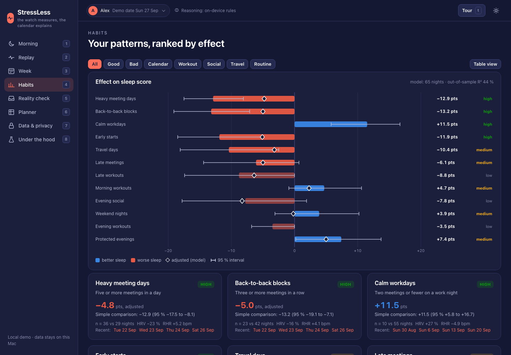
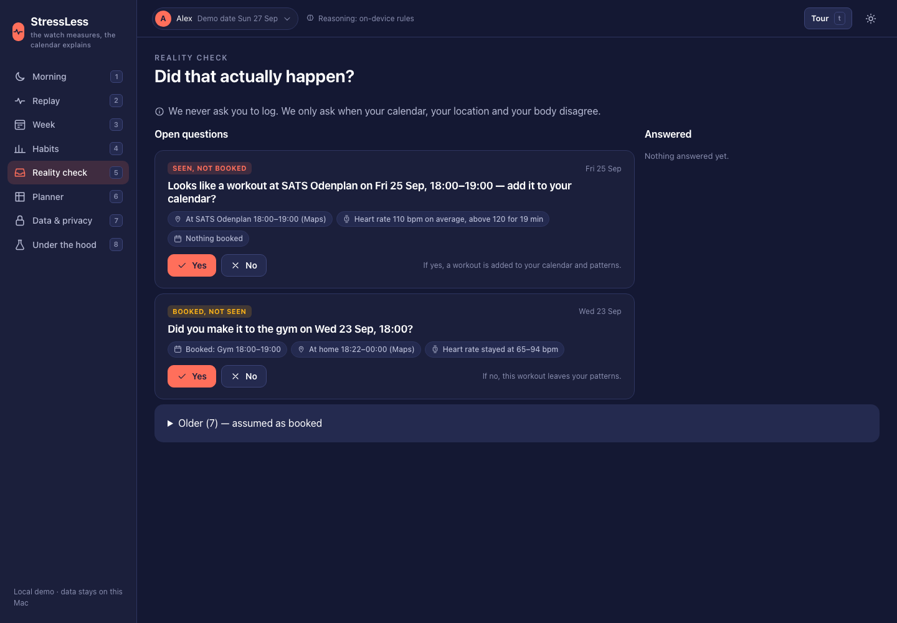
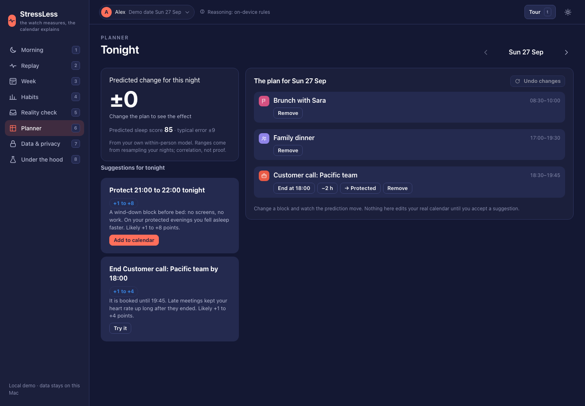
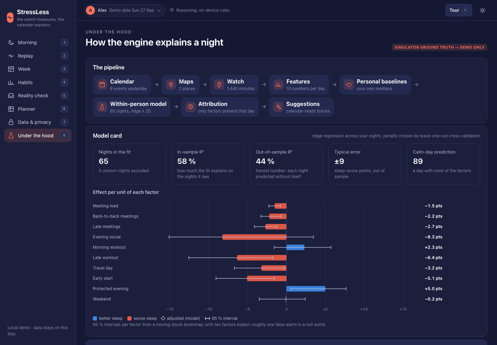
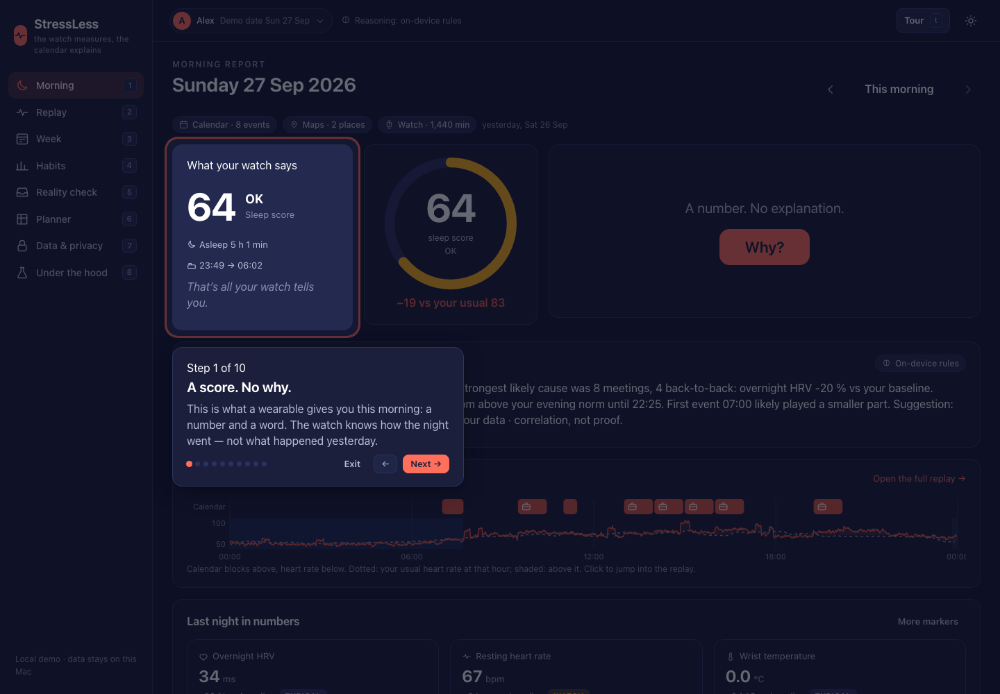

# Project Course DH2465

# StressLess — demo

> Wearables give you a score. They don't tell you why.
> StressLess connects your calendar and your location history to the biometrics your watch already
> collects, and explains what in your day shaped your body and your sleep.

This repository is a **web demo** of the StressLess product: a Next.js frontend and a FastAPI backend,
deployed together on Vercel, with Supabase for sign-in and per-user storage. Because there is no Apple
Watch in the loop yet, the demo uses a **digital twin**: a simulated person whose calendar, Google Maps
history and watch data are generated from a known causal model. Everything downstream — the explanation
engine, the morning report, reality checks, habits, the planner — is the real product logic, and it runs
unchanged on imported real data (Apple Health export, Google Calendar `.ics`, Google Takeout).

Every account gets its own demo. The dataset itself is never stored: the API regenerates it from the
account's persona, seed and date (about 0.15 s, cached on warm instances) and replays the user's own
answers, added events and accepted suggestions on top. Only those few rows live in Supabase, protected by
row-level security.

## Architecture

```
browser ──► Next.js (app/, components/)          React views, charts, tour; Supabase Auth session in cookies
   │            proxy.ts                         refreshes the session, sends signed-out visitors to /login
   └─ /api/* ─► FastAPI (api/index.py → backend/stressless)
                    verifies the Supabase JWT, regenerates the user's dataset, runs the engine
                    └─► Supabase Postgres (PostgREST, as the user)   profiles, answers, user_events,
                                                                      accepted, narratives — RLS per user
```

## Setup

Requirements: Node.js 20+, [uv](https://docs.astral.sh/uv/) (Python 3.12) and a Supabase project.

1. **Supabase.** Create a project, then run `supabase/migrations/20261004000000_stressless_user_state.sql`
   in the SQL editor (or `supabase db push` with the Supabase CLI). Under Authentication → URL
   Configuration, set the Site URL to your deployed URL and add `http://localhost:3000/**` and
   `https://<your-app>.vercel.app/**` to the redirect URLs. Email confirmation stays on: new accounts
   confirm their address through the link in the email, which lands on `/auth/confirm`.
2. **Environment.** `cp .env.example .env.local` and fill in `NEXT_PUBLIC_SUPABASE_URL` and
   `NEXT_PUBLIC_SUPABASE_ANON_KEY` (Project Settings → API). Projects that still use the legacy
   JWT secret also need `SUPABASE_JWT_SECRET`; projects on asymmetric signing keys (the default) do not.
   The Calendar view's Google connection needs five more server-side variables (`APP_URL`,
   `GOOGLE_CLIENT_ID`, `GOOGLE_CLIENT_SECRET`, `GOOGLE_TOKEN_ENCRYPTION_KEY`, `SUPABASE_SERVICE_ROLE_KEY`; see
   `.env.example`) and `<APP_URL>/api/calendar/google/callback` registered as a redirect URI on the Google
   OAuth client. Without them the rest of the app works and the Calendar view reports it is not configured.
3. **Install and run.**

   ```bash
   npm install
   uv sync
   npm run dev          # Next.js on http://localhost:3000 and FastAPI on :8000 (proxied under /api)
   ```

4. **Tests.** `npm run test:api` runs the Python suite (engine, simulator, connectors, API with an
   in-memory store); `npm run typecheck` checks the frontend.

## Deploy to Vercel

Import the repository in Vercel (framework: Next.js). `api/index.py` becomes a Python function serving
`/api/*` with the packages from `requirements.txt`; `vercel.json` keeps the frontend out of its bundle.
Set the same environment variables as in `.env.local` for Production and Preview, then deploy. To freeze
"today" for a presentation, set `STRESSLESS_ANCHOR=2026-09-27` — every account then sees the same
dates, and the screenshots and numbers below stay reproducible.

## The demo in eight beats

Press `t` (or click **Tour**) to walk these steps with the arrow keys.

1. **Problem.** The Morning view opens like a wearable app: *Score 68 · 6 h 12 min · that's all your
   watch tells you.*
2. **Why?** One click reveals three likely causes with evidence — "Meeting until 20:15: heart rate
   11 bpm above your evening norm until 22:00" — and a suggestion you can put straight into the
   calendar. Click **Add to calendar**.
3. **Replay** (`2`). The day plays back from the evening: heart rate riding above the dotted
   "your usual" line after the late meeting, then bedtime.
4. **Reality check** (`5`). The watch saw a workout the calendar did not know about. Answer **Yes**
   and see the pattern update: *Late workout: −4.1 → −4.6 pts (11 → 10 nights)*.
5. **Week** (`3`). Average sleep score by meeting load over six weeks, and the strongest pattern.
6. **Planner** (`6`). End tonight's 19:30 meeting at 18:00 and watch the predicted score rise, with
   a likely range. The protected block you accepted is already there.
7. **Same engine, different person.** Switch persona in the top bar (Alex → Sam → Robin, under a
   second). Different life, different #1 cause.
8. **Under the hood** (`8`). The engine compared against the planted truth, a planted null factor,
   out-of-sample skill, and everything the calendar cannot see. Drag the cold-start slider to seven
   nights and watch the confidence intervals widen.

Keyboard: `1`–`8` switch views, `←`/`→` change day, `t` tour, `d` light/dark theme (use light on a
bright projector), `?` help.

## Screenshots

| Morning report | Replay |
|---|---|
|  |  |

| Week | Habits |
|---|---|
|  |  |

| Reality check | Planner |
|---|---|
|  |  |

| Under the hood | Presenter tour |
|---|---|
|  |  |

Regenerate them against a running instance with `STRESSLESS_EMAIL=… STRESSLESS_PASSWORD=… npm run screenshots`
(add `-- --url https://<your-app>.vercel.app` for a deployment; needs `npx playwright install chromium` once).

## What you are looking at

| View | What it shows |
|---|---|
| Morning | Sleep score, three likely causes with evidence, a calendar-ready suggestion, recovery markers (resting HR, breathing rate, blood oxygen), the night in numbers, and how confident the engine is |
| Replay | A 24-hour timeline: calendar events, where you were (Maps), minute heart rate against your personal norm, sleep; a live watch face while it plays |
| Week | Ten-week score calendar, sleep score by meeting load, strongest pattern, top habits |
| Habits | Every recurring pattern ranked by effect, with intervals, sample sizes and the adjusted (model) effect next to the simple comparison |
| Reality check | Questions asked only when calendar, location and body disagree — booked but not seen, seen but not booked |
| Planner | What-if for today or the coming week; accepted suggestions land in the calendar and as `.ics` |
| Data & privacy | What is connected, which data classes are read and why, persona and seed, importing your own data (coming soon), delete everything |
| Calendar | Connect a Google Calendar (read-only), sync its events, disconnect |
| Under the hood | Pipeline, model card (in-sample vs out-of-sample fit), validation against planted truth, hidden factors, why this is not circular, cold-start slider, open challenges |

## How the engine works (and what it does not claim)

1. **Features.** Each day's calendar becomes a handful of numbers: meetings beyond three, longest
   back-to-back chain, hours a meeting ran past 18:00, evening social, morning or late workout,
   travel, early start, protected evening. Events you said you did not attend are excluded.
2. **Personal baselines.** Every biometric is compared with your own recent nights (robust median and
   spread), never with population norms.
3. **Within-person model.** A ridge regression across your nights, with the penalty chosen by
   leave-one-out cross-validation. The footer reports the *out-of-sample* share of night-to-night
   variation the calendar explains, not the flattering in-sample number.
4. **Attribution.** Only factors present on that day are listed; each contribution is the model's
   effect for that factor, with a block-bootstrap interval and a confidence badge that depends on how
   many similar nights exist.
5. **Evidence.** Each cause is backed by what the watch measured: heart rate above your evening norm
   after a late meeting, resting heart rate above baseline after a heavy day, bedtime later than usual after dinner.
6. **Honesty.** When a night is worse than the calendar predicts, the report says so and names the
   things a calendar cannot see: alcohol, caffeine, screens, sleep debt, illness. The Lab shows how
   often those hidden factors occurred in the simulation and how often the engine flagged them.

This is correlation from one person's data. The product says "was followed by" and "is associated
with", never "caused".

## Personas

| | Alex | Sam | Robin |
|---|---|---|---|
| | Product lead who lives by the calendar | Consultant: eight meetings and a flight | Founder: late nights and late workouts |
| Signature bad day | Six meetings, four back-to-back, a call until 20:15 | Flight home plus a client dinner | Investor update at 19:00, gym at 20:45 |

Same seed, same anchor date, same data — every time. Change persona and seed under Data & privacy; freeze
the date with `STRESSLESS_ANCHOR`.

## Bring your own data

The Media tab has separate Spotify, Netflix and Steam sections, with scrollable histories, library browsing,
and the Morning view's typography and section reveals. It displays imported data without requesting media
insights, statistical correlations, or Claude analysis.

- **Spotify:** import music/podcast history JSON, including Extended Streaming History. Taste Profile,
  Your Library and Wrapped summaries are also supported. Select history files together.
- **Netflix:** download Viewing activity from each Netflix profile and select the CSVs together.
  `Title,Date` exports accept `M/D/YY`, `M/D/YYYY`, and ISO dates. Each filename labels its profile;
  keep filenames stable when reimporting. Missing titles remain visible as “Title unavailable”. Dates
  carry no time of day, and duration is unavailable unless the CSV supplies `Duration` as `HH:MM:SS`.
- **Steam:** import one JSON response from [GetOwnedGames or GetRecentlyPlayedGames](https://partner.steamgames.com/doc/webapi/IPlayerService).
  Request `include_appinfo=true` for GetOwnedGames to include names. Both the full `{ "response": { "games": [...] } }`
  envelope and `{ "games": [...] }` work. Displayed playtime is in-game cumulative minutes, converted to hours;
  snapshots do not supply individual play sessions. Library search and sorting happen locally.
  Steam can also refresh directly using **Sync now** after the setup below. Scheduled sync is not enabled.

History imports replace that provider's history; choose all files to retain in one import (up to 20 files,
4 MB combined). Overlapping records in the same import are deduplicated. A Steam import replaces its previous
library snapshot. The server discards the original uploads and persists normalized history in `media_events`
and summaries/snapshots in `media_documents`, protected by per-user row-level security. Apply migrations,
including `20261022000000_steam_library_import.sql`, before using Steam imports against Supabase.

Last.fm provides ongoing listening history through its official API. Its scrobbles are displayed separately
from Spotify exports to avoid adding overlapping play counts together. No playback duration is inferred.

### Last.fm listening and artwork

1. Create a [Last.fm API account](https://www.last.fm/api/account/create) for the app. One API key serves every
   user; no shared secret, authentication callback or Spotify developer application is needed.
2. Set the server-only variable in `.env.local` (and in the Vercel project's environment variables):

   ```env
   LASTFM_API_KEY=your_lastfm_api_key
   ```

   Each user then connects their own account under Media → Last.fm: they create a Last.fm account, enable
   [Spotify scrobbling](https://www.last.fm/about/trackmymusic), keep their recent listening public and enter
   their username. The API checks the username with Last.fm and keeps it in the user's `lastfm_sync` document.
   **Disconnect** deletes that document and the user's saved scrobbles, so two Last.fm accounts never mix.
3. Apply `supabase/migrations/20261022133929_lastfm_media_sync.sql` in Supabase's SQL editor (or your normal
   migration workflow). It extends the `media_events` provider constraint and the existing atomic import RPC.
   Last.fm events merge by a stable ID; file histories keep their replacement behavior. Sync progress is a
   `lastfm_sync` document in `media_documents`. Existing media remains intact.
4. Restart `npm run dev`, reload Media and click **Sync now** in Last.fm under Listening. Each request reads
   up to 200 completed scrobbles. **Load older listening** pages through older history. **Continue sync** appears
   when a large new-listening backlog needs another batch; fixed time windows keep new tracks from shifting
   those pages. Repeating a sync does not duplicate saved scrobbles. Now-playing tracks are not saved as plays.

Album artwork is displayed in the featured latest listen and history thumbnails. Safe HTTPS image URLs from
Last.fm's image CDNs are used directly. If a track has no artwork, a visible cover triggers a cached
`album.getInfo` lookup through the authenticated backend. Repeated album lookups share requests and are paced;
missing or broken covers fall back to a music icon. Listening data/artwork link back to Last.fm.

Last.fm calls use your server-side key and are limited to the configured app user. API errors preserve saved
history and paging progress; no credentials are returned to the browser. Username changes are rejected while
history for a different username is saved. Scrobbles have no exact listening duration, and enabling scrobbling
does not recover listening Last.fm never recorded. Sync runs on button presses, without Claude, statistical
analysis or scheduled polling.

### Steam Sync now (your own account)

1. Sign in locally and open **Media → Steam → Set up Steam sync**. Copy **Your app user ID**.
   This is your Supabase Auth UUID; it is also listed under Supabase → Authentication → Users.
2. Register a personal [Steam Web API key](https://steamcommunity.com/dev/apikey) and find your **SteamID64**
   (17 digits, not your login name or custom profile URL). Check your Steam account details for the Steam ID.
3. Under Steam → Edit Profile → Privacy Settings, make **My profile** and **Game details** public.
   To expose playtime, also disable “Always keep my total playtime private”.
4. Add these server-only variables to the existing `.env.local`:

   ```env
   STEAM_WEB_API_KEY=your_personal_steam_api_key
   STEAM_ID=your_17_digit_steam_id
   STEAM_SYNC_USER_ID=your_supabase_auth_user_uuid
   ```

5. Apply `supabase/migrations/20261022000000_steam_library_import.sql` if it has not already been applied.
   No additional migration is needed for the button. Restart `npm run dev` so the backend reloads `.env.local`.
6. Reload [Media](http://localhost:3000/media), go to Steam, and click **Sync now**. The games, playtime and
   last-synced timestamp update after the snapshot is saved. Errors leave the previous snapshot intact.

The configured Steam library can only be synced by `STEAM_SYNC_USER_ID`. The API key is sent to Steam in
the `x-webapi-key` header, never returned to the browser or persisted in `media_documents`. No service-role
key, Claude key, statistical-engine connection or scheduler is required. This is a personal server-side
configuration; other users can continue to import their own files. Both `media_events` and `media_documents`
remain in use. Steam sync updates its snapshot in `media_documents` without changing Spotify or Netflix data.

### Automatic Netflix and Steam artwork

Steam imports and Sync now attach official header-image URLs using each game's app ID. Game cards display
these images automatically; missing/removed artwork keeps the existing gamepad placeholder. No new Steam
credential, image upload or database migration is needed for Steam artwork. Sync/import once to populate old
snapshots with the new image URLs.

Netflix's CSV does not include artwork. StressLess can fetch series/movie posters from TMDB automatically
after a successful import:

1. Create a [TMDB API account](https://www.themoviedb.org/settings/api) and copy its **API Read Access Token**
   (the Bearer token, not the shorter v3 API key).
2. Add `TMDB_READ_ACCESS_TOKEN=...` to `.env.local`. Optionally set `TMDB_LANGUAGE=sv-SE` (the default).
3. Apply `supabase/migrations/20261022142351_netflix_artwork.sql`. It adds a user-scoped RPC/index to patch
   poster metadata in `media_events.source` while preserving titles, dates, profiles and all other records.
4. Restart `npm run dev` and import all Netflix CSVs together. Existing uploads need one reimport to attach
   catalogue lookup keys. No individual images need to be supplied.

After the history is saved, the import UI automatically processes small poster batches and displays progress.
Episodes share a show lookup/poster. Exact normalized titles and original titles are matched; ambiguous titles,
remakes without a distinguishing year, missing covers and unknown titles remain placeholders. Only title search
queries are sent to TMDB, without viewing dates or profile filenames. Requests are cached and credentials stay
on the server. **Fetch missing posters** resumes interrupted work; no metadata lookup starts just by opening
the page. Network/API failures do not discard imported history. TMDB attribution is displayed under Netflix.

The original health and calendar importers already exist and are tested
(`backend/stressless/connectors/`): Apple Health (Settings → Health → Export All Health Data), Google
Calendar (Settings → Import & export → Export) and Google Maps (Google Takeout → Location History, both the
monthly Semantic Location History files and the newer `Timeline.json`). Note that Vercel limits request
bodies to 4.5 MB, so large Apple Health exports will need direct-to-storage uploads.

## Optional: Claude writes the reports

The daily and weekly reports on Home are written by rules by default. To let Claude write them, set
`STRESSLESS_REASONER=claude` and `ANTHROPIC_API_KEY` (in `.env.local`, or in the Vercel project), and pick the
models with `STRESSLESS_DAILY_MODEL` / `STRESSLESS_WEEKLY_MODEL`. The narrative on the Morning view is always
written by rules and never calls a model.

## Scripts

```bash
npm run dev            # Next.js + FastAPI with reload
npm run dev:next       # only Next.js (expects the API on :8000)
npm run dev:api        # only FastAPI (uv run uvicorn api.index:app --port 8000)
npm run build          # production build of the frontend
npm run typecheck      # TypeScript
npm run test:api       # Python test suite
npm run screenshots    # render every view with headless Chromium into docs/screenshots
```

## Project layout

```
app/                   Next.js App Router: login, /auth/confirm, and one route per view
components/            React views, SVG charts, app shell, presenter tour, overlays
lib/                   API client, Supabase clients, formatting, icons, navigation
styles/                the design system and per-view CSS
proxy.ts               session refresh and sign-in gate (Next.js 16 proxy)
api/index.py           Vercel entrypoint for the FastAPI app
backend/stressless/
  models.py            shared data model (dataclasses, JSON round-trip)
  timeutil.py          time conventions (nights, day-relative hours)
  sim/                 the digital twin: personas, calendar, location, physiology, sleep score, showcase
  connectors/          Apple Health, .ics and Google Takeout importers; demo sources
  store/               per-user state: Supabase (PostgREST) and in-memory stores
  engine/              features, baselines, matching, reality checks, attribution, habits, what-if,
                       suggestions, reasoning, pipeline
  server/              FastAPI app, Supabase JWT auth, per-request engine sessions
backend/tests/         unittest suite
supabase/migrations/   tables, row-level security and RPCs for per-user state
tools/                 screenshots (Playwright) and palette validation
```

## Known limitations

* One person's data: correlation, not proof — and the app says so on every report.
* The simulator is a caricature of a life. It is honest about its causal model (see Under the hood),
  but it is not a physiological model.
* The DST change night is off by one hour in durations.
* The demo dataset follows the calendar: when the day changes, each account gets a fresh dataset for
  the new date and its reality-check answers and accepted suggestions are cleared (set
  `STRESSLESS_ANCHOR` to keep one date).
* The calendar misses coffee, alcohol, screens and unbooked stress; the demo shows how the product
  copes with that rather than pretending otherwise.
# YouTube watch-history import

YouTube imports default to the last 90 days, with a choice of 30 days or all history. Every choice is capped
at the latest 5,000 unique viewing entries across the selected files, before the Supabase write. The result
shows imported and skipped counts. Empty date selections preserve existing history. This limits bulk-write
cost without changing database execution timeouts; the earlier YouTube provider migration is still required.

Apply `supabase/migrations/20261023000000_youtube_media_import.sql` after the existing media migrations.
This extends the media provider constraint and atomic replacement RPC; it keeps using `media_events`.
No YouTube API key or OAuth setup is needed. In Media, below Netflix, open **Import YouTube JSON** and
upload the extracted Google Takeout `watch-history.json`. Select all parts together for split exports:
each successful import replaces only YouTube history. Invalid or search-only uploads preserve existing data.

Viewing entries include exported timestamps (displayed in the browser's local timezone), channel names
when present, canonical video links, and lazy YouTube thumbnails with icon fallbacks. Actual watch duration
is unknown and is not inferred from video runtime. Search/channel activity is excluded. Exact duplicate
entries are deduplicated, while repeat views at different timestamps are retained.

The backend accepts up to 32 MB total for YouTube JSON (other sources remain 4 MB). Your hosting provider
may enforce a smaller request-body limit; if so, split a large JSON array into valid smaller arrays and
select the parts together within that deployment's limit. Larger histories exceeding the deployment's
combined limit will need a future chunked-upload flow. No AI or statistical analysis is connected.
